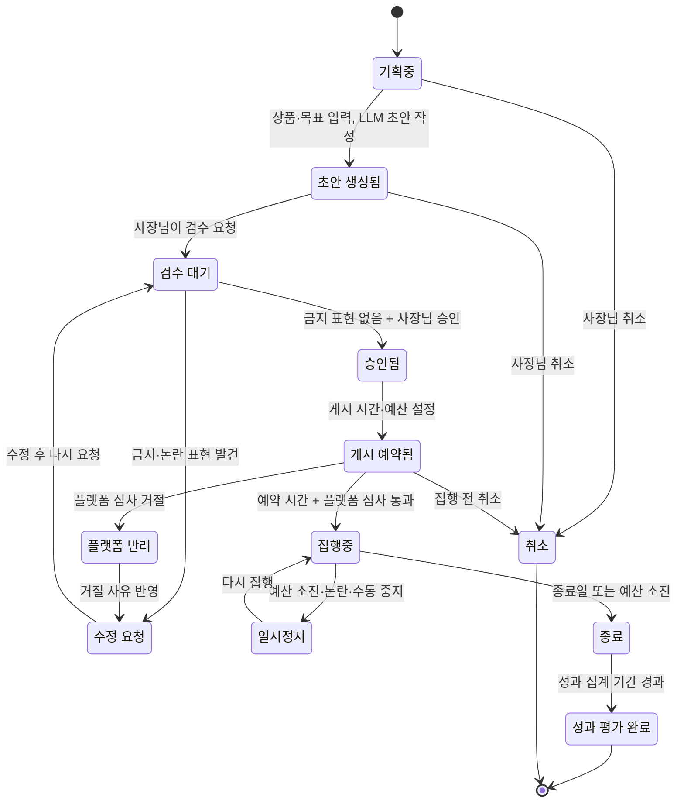

# 3. 규칙, 상태 전이, LLM이 들어갈 자리

> 목표: 클라이언트가 "이 경우엔요?"라고 물을 지점을 우리가 먼저 찾는다. 세부 주제의 필수 조건 두 가지(상태 전이, LLM)가 이 도메인의 어디에 들어갈 수 있는지 찾는다.

## 3-1. 규칙 (최소 5개)

> 규칙은 '항상 / 절대 / ~이면 ~한다' 형태로 씁니다. 예외는 '그런데 만약 ~라면?'으로 찾습니다.
> 예: "배송중이 된 주문은 셀러가 취소할 수 없다" → 만약 고객이 배송중에 취소를 요청하면?

| 번호 | 규칙 | 예외·경계 사례 (만약 ~라면?) | 어기면 생기는 문제 | 태그 | 출처 (카드 번호) |
| --- | --- | --- | --- | --- | --- |
| R1 | 대가(돈·제품·상품권·포인트·할인)를 받고 올린 인플루언서 게시물에는 광고라는 사실을 매 게시물마다, 제목·본문 첫 줄이나 첫 번째 해시태그에 밝혀야 한다 | 제품만 무상으로 받고 "솔직 후기"라고 쓰면? → 제품도 대가에 들어가므로 밝혀야 함. 본문 끝 여러 해시태그 사이에 `#광고`를 달거나 댓글·'더보기' 안에 쓰면? → 적절하지 않은 방법으로 봄 | 뒷광고로 판매자와 인플루언서가 함께 제재를 받을 수 있고, 들키면 신뢰가 무너짐 | `[사실]` 표시광고법 제3조, 추천·보증 심사지침 | 2-harinsd404-02 |
| R2 | 광고성 문자·DM·알림을 보내려면 받는 사람의 명시적인 사전 동의가 있어야 하고, 전송자 이름·연락처와 수신 거부 방법을 밝혀야 한다 | 이미 구매한 고객에게 비슷한 상품 안내를 보내면? → 직접 받은 연락처로 같은 종류 상품을 거래 종료 후 6개월 안에 보내는 것은 동의 없이 가능. 동의를 받은 지 오래되었다면? → 2년마다 동의 여부를 다시 확인해야 함 (3-3) | 3천만원 이하 과태료, 수신 거부와 스팸 신고 증가 | `[사실]` 정보통신망법 제50조·제76조, 시행령 제61조 | 2-harinsd404-01 |
| R3 | 광고 문구는 거짓이거나 과장되면 안 되고, 소비자를 속이거나 부당하게 비교·비방해도 안 된다 ("최고", "1위", "100% 효과" 등은 근거가 있어야 함) | 판매량 1위인데 기간·플랫폼을 밝히지 않으면? 고객 리뷰 문장을 그대로 광고에 옮겨 쓰면? | 허위·과장 광고 제재, 플랫폼 광고 심사 거절 | `[사실]` 거짓·과장·기만·부당비교·비방 금지는 표시광고법 제3조. `[추정]` "1위" 같은 표현에 어떤 근거를 함께 밝혀야 하는지는 시행령·고시를 아직 보지 않음 | 2-harinsd404-02 |
| R4 | 식품은 질병 예방·치료 효능이나 의약품·건강기능식품으로 오해할 표현을, 화장품은 의약품·기능성화장품으로 오해할 표현을 광고에 쓸 수 없다 | "면역력에 좋은", "여드름 진정"은 괜찮은가? 고객 후기에 들어 있는 효능 표현을 광고에 쓰면? | 행정처분, 광고 삭제, 판매 중지 | `[사실]` 식품표시광고법 제8조, 화장품법 제13조. `[추정]` 개별 표현이 금지 표현인지는 총리령 기준을 아직 보지 않음 | 2-harinsd404-03 |
| R5 | 비하·혐오·선정적인 표현이나 논란이 있는 소재가 들어간 콘텐츠는 게시하지 않는다 | 유행어·밈이 특정 집단을 비하하는 뜻을 담고 있다면? 게시 뒤에 함께한 인플루언서에게 논란이 생기면? | 불매·악플, 브랜드 이미지 손상, 플랫폼 계정 제재 | `[가정]` 소상공인이 직접 검수할 시간이 없다는 것은 클라이언트 질문으로 넘김 | 없음 (`[가정]`) |
| R6 | 광고는 사장님이 승인하기 전에는 게시·집행하지 않는다 (서비스 규칙) | 예약 게시 시간이 되었는데 아직 승인하지 않았다면? 승인 뒤에 문구를 고치면 다시 승인을 받아야 하나? | 의도하지 않은 광고비 지출, 잘못된 문구 노출 | `[사실]` 클라이언트 답변 Q3: 홍보 버튼은 사용자가 직접 누름. 승인 뒤 수정 시 재승인 여부는 `[가정]` | [클라이언트 답변](../interview/client-answers-assumptions.md) |
| R7 | 하루·캠페인 광고 예산을 넘겨 집행하지 않는다 | 플랫폼 정산 시차로 실제 지출이 예산을 조금 넘으면? 성과가 좋아 예산을 늘리고 싶다면 누가 승인하나? | 소상공인 현금 흐름 악화 | `[가정]` 대리 광고집행을 할 경우의 규칙 후보 | 없음 (`[가정]`) |

## 3-2. 핵심 대상과 상태 전이

> **필수 조건입니다.** 세부 주제에는 상태가 바뀌는 핵심 대상이 반드시 있어야 합니다. 핵심 대상 후보를 찾아 상태를 적습니다.
>
> 기준:
> - 상태가 **4개 이상**이고, 처음 상태에서 끝 상태까지 순서가 있습니다.
> - 정상 경로 말고 **취소·반려·되돌림·실패 경로가 1개 이상** 있습니다.
> - 전이마다 **누가 바꾸는지, 어떤 조건에서 바꾸는지** 적을 수 있습니다.
>
> 도메인별 예시 (그대로 쓰지 말고 조사한 내용으로 바꿉니다):
>
> | 도메인 | 핵심 대상 | 상태 흐름 예시 |
> | --- | --- | --- |
> | 오픈마켓 셀러 운영 백오피스 | 주문 | 결제완료 → 상품준비중 → 배송지시 → 배송중 → 배송완료 (취소요청 → 취소완료, 반품요청 → 반품완료) |
> | 러닝 자세·훈련 코칭 | 주간 훈련 계획 | 계획됨 → 진행중 → 기록 제출 → 피드백 완료 (기록 부족 → 재측정 요청) |
> | 다문화 가정 행정 절차 안내 | 절차 진행 건 | 준비중 → 서류 확인 → 제출 완료 → 처리 완료 (서류 부족 → 보완 요청 → 서류 확인) |

**핵심 대상 후보**: 마케팅 캠페인 (콘텐츠 기획 → 검수 → 게시·광고 집행 → 성과 평가를 한 묶음으로 보는 단위) `[사실]` 클라이언트 답변 Q1: 광고 한 건 단위로 진행하고, 앞 광고의 성과를 다음 광고에 반영하기를 원함 ([클라이언트 답변](../interview/client-answers-assumptions.md))

> 두 번째 후보: 인플루언서 협업 건 (제안 → 수락/거절 → 계약 → 콘텐츠 제작 → 검수 → 게시 → 정산). 범위가 커서 MVP에서는 선택 기능으로 둡니다. `[가정]`

| 지금 상태 | 다음 상태 | 누가 바꾸나 | 조건 | 되돌릴 수 있나 | 태그 |
| --- | --- | --- | --- | --- | --- |
| 기획중 | 초안 생성됨 | 사장님 (LLM이 초안 작성) | 상품·목표·채널·예산을 입력함 | 예 (다시 기획) | `[가정]` |
| 초안 생성됨 | 검수 대기 | 사장님 | 초안을 확인하고 검수를 요청함 | 예 | `[가정]` |
| 검수 대기 | 승인됨 | 시스템 + 사장님 | 금지 표현 규칙에 걸린 것이 없고(R3~R5), 사장님이 승인함 | 예 (승인 취소 → 초안) | `[가정]` |
| 검수 대기 | 수정 요청 | 시스템 | 금지 표현·논란 위험 표현이 발견됨 | 예 (수정 후 다시 검수 대기) | `[가정]` |
| 승인됨 | 게시 예약됨 | 사장님 | 채널별 게시 시간·광고 예산을 정함 | 예 (예약 취소) | `[가정]` |
| 게시 예약됨 | 집행중 | 시스템 (외부 플랫폼) | 예약 시간이 되고, 플랫폼 광고 심사를 통과함 (Meta는 게재 전 자동 검토, 보통 24시간 안, 2-harinsd404-04) | 아니오 (이미 노출됨) | `[사실]` 심사 절차 / `[가정]` 상태 이름 |
| 게시 예약됨 | 플랫폼 반려 | 외부 플랫폼 | 광고 심사에서 거절됨 | 예 (수정 요청으로 되돌림) | `[추정]` 심사가 있으면 거절도 있음 (2-harinsd404-04) |
| 집행중 | 일시정지 | 사장님 / 시스템 | 예산 소진(R7), 논란 발생, 사장님이 중지함 | 예 (다시 집행중) | `[가정]` |
| 집행중 | 종료 | 시스템 | 종료일이 되거나 예산을 다 씀 | 아니오 | `[가정]` |
| 종료 | 성과 평가 완료 | 시스템 (LLM이 보고서 작성) + 사장님 | 성과 집계 기간이 지나 지표가 확정됨 (3-3) | 아니오 | `[가정]` |
| 기획중~게시 예약됨 | 취소 | 사장님 | 집행 전 언제든 | 아니오 | `[가정]` |

## 3-3. 시간에 따라 달라지는 규칙

> 기한, 마감, 주말·공휴일, 유효기간처럼 시간이 끼는 규칙을 1개 이상 적습니다. 3-2의 상태 전이와 이어지면 더 좋습니다.
> 예: 결제 후 ○영업일 안에 배송지시가 없으면 지연으로 표시한다 / 체류 기간 만료 ○일 전부터 연장 신청을 할 수 있다

| 규칙 | 기준 시간 | 주말·공휴일이면? | 태그 | 출처 (카드 번호) |
| --- | --- | --- | --- | --- |
| 밤 시간(오후 9시~다음 날 오전 8시)에는 별도 사전 동의를 받지 않은 고객에게 광고 메시지를 보내지 않는다 (전자우편은 예외) → 예약 시간이 이 구간이면 게시 예약됨 상태에서 보류 | 메시지를 보내는 시각 | 주말·공휴일도 같은 기준 (법 조문에 요일 구분 없음) | `[사실]` 정보통신망법 제50조 제3항, 시행령 제61조 제2항 | 2-harinsd404-01 |
| 광고 수신 동의는 동의를 받은 날부터 2년마다 다시 확인해야 한다 (확인하지 않으면 과태료) | 동의를 받은 날 | 영향 없음 | `[사실]` 정보통신망법 제50조 제8항, 시행령 제62조의3 | 2-harinsd404-01 |
| 플랫폼 광고 심사는 시간이 걸리므로 게시 예약은 심사 요청 뒤 최소 24시간 여유를 두고 해야 한다 | 심사 요청 시각 | 주말에는 심사가 늦어질 수 있음 `[가정]` (문서에 언급 없음) | `[사실]` Meta는 보통 24시간 안, 더 걸릴 수 있음. `[가정]` TikTok·X의 심사 시간은 확인하지 못함 | 2-harinsd404-04 |
| 성과 평가는 플랫폼의 전환 집계 기간이 지난 뒤에 확정한다 (종료 → 성과 평가 완료) | 캠페인 종료 시각 | 영향 없음 | `[추정]` Meta는 웹 구매 같은 외부 전환을 구매 시점 기준으로 집계하므로 종료 뒤에도 숫자가 늘 수 있음. 기여 기간 일수는 문서에서 찾지 못함 | 3-harinsd404-01 |
| 인플루언서 게시물은 계약에 정한 기간 동안 내리지 않고 유지한다 | 게시일 | 계약 내용에 따름 | `[가정]` 클라이언트 질문으로 넘김 | 없음 (`[가정]`) |

## 3-4. LLM이 들어갈 자리

> **필수 조건입니다.** 세부 주제에는 LLM이 **서비스 기능 안에서** 쓰여야 합니다. 개발할 때 Claude를 쓰는 것은 여기에 해당하지 않습니다. 사용자가 서비스를 쓰는 동안 LLM이 무엇을 해 주는지 찾습니다.
>
> 좋은 자리를 고르는 기준:
> - 지금 사람이 **글을 읽고 쓰거나, 설명을 바꾸거나, 분류하는 데** 시간이 드는 곳 (2-2 As-Is의 문제 지점)
> - LLM이 틀려도 **사람이 확인하거나 규칙으로 걸러 낼 수 있는** 곳
> - 상태를 바꾸는 최종 결정은 **규칙이나 사람**이 하고, LLM은 초안·요약·분류·설명을 맡습니다
>
> 도메인별 예시:
>
> | 도메인 | LLM이 하는 일 | 사람이 확인하는 곳 |
> | --- | --- | --- |
> | 오픈마켓 셀러 운영 백오피스 | 고객 문의를 읽고 유형(취소·반품·배송 문의)을 분류하고 답변 초안 작성 | CS 담당이 고쳐서 보냄. 취소·반품 상태 변경은 규칙대로 |
> | 러닝 자세·훈련 코칭 | 러너가 남긴 훈련 기록과 느낌을 요약하고 다음 주 조정 제안 작성 | 코치가 승인해야 계획에 반영. 통증 언급은 의료 상담 권유로 |
> | 다문화 가정 행정 절차 안내 | 공식 안내문을 이용자의 언어와 쉬운 말로 바꾸고, 필요한 서류 목록을 뽑기 | 상담원이 원문과 비교해 확인. 법적 판단은 하지 않음 |

| 후보 | LLM에 넣는 것 (입력) | LLM이 내놓는 것 (출력) | 누가 보고 확인하나 | 틀리면 생기는 일 | 이어지는 상태 전이 | LLM에 보내면 안 되는 정보 (2-3 개인정보) | 태그 |
| --- | --- | --- | --- | --- | --- | --- | --- |
| L1 콘텐츠 초안·채널별 변환 | 상품 정보(이름, 특징, 가격), 캠페인 목표, 타깃층, 채널(인스타그램·X·틱톡) | 채널 형식에 맞춘 게시글·캡션·해시태그 초안, 콘텐츠 기획 시나리오 | 사장님이 고치고 승인 | 상품 사실과 다른 문구, 과장 표현 노출 | 기획중 → 초안 생성됨 | 고객 이름·연락처·주소, 매입 단가 등 영업 비밀 | `[추정]` SNS 교육을 받지 못한 소상공인은 SNS 활용이 낮음 (1-harinsd404-01). Meta도 문구 생성 AI를 제공하므로 생성만으로는 차별점이 약함 `[사실]` (4-harinsd404-01) |
| L2 광고 문구 검수·논란 감지 | 승인 전 광고 문구, 상품 카테고리 | 위험 표현 목록(과장, 효능 표방, 비하·혐오)과 이유, 고쳐 쓴 문장 제안 | 금지어 규칙 목록으로 한 번 더 거르고, 최종 판단은 사장님 | 위험 표현을 놓치면 제재·논란, 너무 많이 잡으면 사장님이 기능을 무시함 | 검수 대기 → 승인됨 / 수정 요청 | 해당 없음 (광고 문구만 보냄) | `[사실]` 걸러야 할 표현의 법적 근거 (2-harinsd404-02, 2-harinsd404-03). `[추정]` 플랫폼 AI는 국내 법규 검수를 하지 않음 (4-harinsd404-01에 언급 없음) |
| L3 광고 성과 보고서·리뷰 요약 | 플랫폼에서 받은 성과 지표(노출, 클릭, 전환, 지출), 상품 리뷰 본문 | 쉬운 말로 쓴 성과 요약, 고객이 자주 말한 장점·불만, 다음 캠페인 제안 | 사장님이 읽고 다음 캠페인에 반영할지 결정 | 숫자를 잘못 해석해 잘못된 결정을 내림 → 숫자는 시스템이 계산하고 LLM은 설명만 | 종료 → 성과 평가 완료 | 리뷰 작성자 이름·아이디, 주문 번호 | `[추정]` 외부 전환은 종료 뒤에도 늘어나므로 숫자는 시스템이 집계 기간 뒤에 확정 (3-harinsd404-01) |

> 걸러 낸 것: 광고 효과·매출 예측의 **숫자 자체**는 LLM이 아니라 통계·규칙으로 계산해야 합니다. "AI 페르소나로 소비자 반응 예측"은 결과를 확인할 방법이 없어 참고용 의견으로만 둡니다. `[추정]` 실제 소비자 반응과 비교할 데이터가 캠페인이 끝나야 생기기 때문
> 덧붙임: AI로 만든 가상 인물이 상품을 추천하는 콘텐츠를 L1이 만들면, 가상인물임을 게시물 제목이나 첫 부분에 밝혀야 합니다. `[사실]` 추천·보증 심사지침 (2-harinsd404-02)

## 3-5. 법령·통계·보고서로 확인하기

> 팀 합계 3개 이상. 3-1 규칙과 ⑤ 손해처럼 근거가 약한 내용을 자료로 확인합니다. 이 중 1개 이상은 `[추정]`·`[가정]`을 `[사실]`로 바꾸거나, 반대로 틀렸다는 것을 확인한 것이어야 합니다.
> 자료마다 [카드](cards/_template.md)를 한 장씩 만들고, 여기에는 목록만 적습니다. 조항 번호나 숫자는 카드에 자료에 적힌 그대로 옮깁니다.

| 자료 종류 | 카드 번호 | 자료명 (짧게) | 확인한 내용 요지 | 태그 변화 | 반영한 표 |
| --- | --- | --- | --- | --- | --- |
| 법령 | 2-harinsd404-02 | 표시·광고의 공정화에 관한 법률 제3조 + 추천·보증 등에 관한 표시·광고 심사지침 | 거짓·과장·기만·부당비교·비방 광고 금지. 제품·할인 등 대가를 받은 추천은 매 건마다 첫 부분이나 첫 번째 해시태그에 밝혀야 하고, 댓글·'더보기'·여러 해시태그 사이는 적절하지 않음. AI 가상인물은 가상인물임을 밝혀야 함 | R1 `[추정]` → `[사실]`, R3 `[추정]` → `[사실]` (일부 `[추정]` 유지) | 3-1 R1, R3 / 3-4 |
| 법령 | 2-harinsd404-01 | 정보통신망법 제50조·제76조와 시행령 제61조·제62조의3 | 광고성 정보는 명시적 사전 동의 필요 (거래 종료 후 6개월 안 같은 종류 상품은 예외), 오후 9시~오전 8시는 별도 동의 (전자우편 예외), 동의는 2년마다 확인, 어기면 3천만원 이하 과태료 | R2·3-3 두 규칙 `[추정]` → `[사실]` | 3-1 R2, 3-3 |
| 법령 | 2-harinsd404-03 | 식품 등의 표시·광고에 관한 법률 제8조 / 화장품법 제13조 | 식품은 질병 예방·치료 효능, 의약품·건강기능식품 오인 광고 금지. 화장품은 의약품·기능성화장품 오인 광고 금지 | R4 `[추정]` → `[사실]` (개별 표현 기준은 `[추정]` 유지) | 3-1 R4 |
| 서비스 문서 | 2-harinsd404-04 | Meta 광고 기준 (Transparency Center) | 광고 검토는 게재 전 자동으로 시작되고 보통 24시간 안에 끝나지만 더 걸릴 수 있음 | 3-3 심사 기간 `[추정]` → `[사실]` (Meta 한정) | 3-2, 3-3 |
| 서비스 문서 | 3-harinsd404-01 | Meta Insights API – Limits & Best Practices | 성과는 광고 세트의 기여 설정을 따르고, 웹 구매 같은 외부 전환은 전환 시점 기준으로 집계됨 | 3-3 성과 확정 시점 `[추정]` 유지, 근거 보강 | 3-2, 3-3, 3-4 L3 |
| 논문 | 1-harinsd404-01 | SNS특성이 SNS활용과 경영성과에 미치는 영향 (윤성임, 한성대 석사학위논문, 2018) | 소상공인의 SNS 활용에는 SNS 교육이 조절효과를 가지며, 최신성·신뢰성·유희성이 경영성과에 긍정적 영향 | "사장님이 혼자 마케팅하기 어렵다" `[가정]` → `[추정]` | 3-4 L1 |
| 서비스 문서 | 4-harinsd404-01 | Meta Advantage+ 빠르게 이해하기 (Meta 뉴스룸, 2025.4.) | Advantage+ 크리에이티브는 생성형 AI로 문구 생성·비율 조정·모션 추가를 해 줌. 국내 법규 검수 언급 없음 | 플랫폼 AI 문구 생성 `[사실]` (새로 확인) | 3-4 L1, L2 |
| 통계 | 5-harinsd404-01 | 2024년 기준 소상공인실태조사 (중소벤처기업부·소상공인시장진흥공단, 2026.3. 발표, 언론 보도) | 소상공인 613만 4천 개, 디지털·스마트 기술 활용 27.2% (그중 온라인 판로 49.0%), 경영 애로 1위 경쟁 심화 61.0% | ⑤ 디지털 활용·경영 애로 `[가정]` → `[사실]`, 마케팅 어려움 비율은 `[가정]` 유지 | ⑤ 문제와 손해 |
