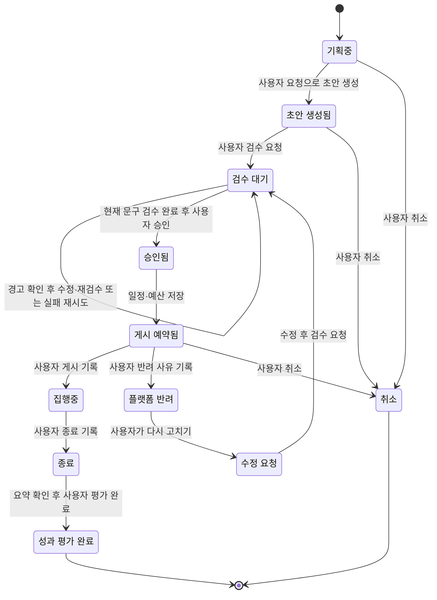

# 3. 규칙, 상태 전이, LLM이 들어갈 자리

> 2026-11-17 최신 반영: [중간 미팅 보고서](../interview/mid-meeting-report.md)에 맞춰 3-2의 MVP 상태 전이와 3-4의 LLM 경계를 정리했다. 3-1·3-3·3-5의 법령·플랫폼 자료는 기존 조사 기록이며 이번에 최신 법령·외부 정책을 재검증한 것은 아니다. 실제 MVP에서는 게시·종료·성과 입력이 수동이며, 초기 조사에서 다룬 일시정지·자동 집행·메시지 발송은 제외한다.

> 목표: 클라이언트가 "이 경우엔요?"라고 물을 지점을 우리가 먼저 찾는다. 세부 주제의 필수 조건 두 가지(상태 전이, LLM)가 이 도메인의 어디에 들어갈 수 있는지 찾는다.

## 3-1. 규칙 (최소 5개)

> 규칙은 '항상 / 절대 / ~이면 ~한다' 형태로 씁니다. 예외는 '그런데 만약 ~라면?'으로 찾습니다.
> 예: "배송중이 된 주문은 셀러가 취소할 수 없다" → 만약 고객이 배송중에 취소를 요청하면?

| 번호 | 규칙 | 예외·경계 사례 (만약 ~라면?) | 어기면 생기는 문제 | 태그 | 출처 (카드 번호) |
| --- | --- | --- | --- | --- | --- |
| R1 | 대가(돈·제품·상품권·포인트·할인)를 받고 올린 인플루언서 게시물에는 광고라는 사실을 매 게시물마다, 제목·본문 첫 줄이나 첫 번째 해시태그에 밝혀야 한다 | 제품만 무상으로 받고 "솔직 후기"라고 쓰면? → 제품도 대가에 들어가므로 밝혀야 함. 본문 끝 여러 해시태그 사이에 `#광고`를 달거나 댓글·'더보기' 안에 쓰면? → 적절하지 않은 방법으로 봄 | 뒷광고로 판매자와 인플루언서가 함께 제재를 받을 수 있고, 들키면 신뢰가 무너짐 | `[사실]` 표시광고법 제3조, 추천·보증 심사지침 | 2-harinsd404-02 |
| R2 | 광고성 문자·DM·알림을 보내려면 받는 사람의 명시적인 사전 동의가 있어야 하고, 전송자 이름·연락처와 수신 거부 방법을 밝혀야 한다 | 이미 구매한 고객에게 비슷한 상품 안내를 보내면? → 직접 받은 연락처로 같은 종류 상품을 거래 종료 후 6개월 안에 보내는 것은 동의 없이 가능. 동의를 받은 지 오래되었다면? → 2년마다 동의 여부를 다시 확인해야 함 (3-3) | 3천만원 이하 과태료, 수신 거부와 스팸 신고 증가 | `[사실]` 정보통신망법 제50조·제76조, 시행령 제61조 | 2-harinsd404-01 |
| R3 | 광고 문구는 거짓이거나 과장되면 안 되고, 소비자를 속이거나 부당하게 비교·비방해도 안 된다 ("최고", "1위", "100% 효과" 등은 근거가 있어야 함) | 판매량 1위인데 기간·플랫폼을 밝히지 않으면? 고객 리뷰 문장을 그대로 광고에 옮겨 쓰면? | 허위·과장 광고 제재, 플랫폼 광고 심사 거절 | `[사실]` 거짓·과장·기만·부당비교·비방 금지는 표시광고법 제3조. `[추정]` "1위" 같은 표현에 어떤 근거를 함께 밝혀야 하는지는 시행령·고시를 아직 보지 않음 | 2-harinsd404-02 |
| R4 | 식품은 질병 예방·치료 효능이나 의약품·건강기능식품으로 오해할 표현을, 화장품은 의약품·기능성화장품으로 오해할 표현을 광고에 쓸 수 없다 | "면역력에 좋은", "여드름 진정"은 괜찮은가? 고객 후기에 들어 있는 효능 표현을 광고에 쓰면? | 행정처분, 광고 삭제, 판매 중지 | `[사실]` 식품표시광고법 제8조, 화장품법 제13조. `[추정]` 개별 표현이 금지 표현인지는 총리령 기준을 아직 보지 않음 | 2-harinsd404-03 |
| R5 | 비하·혐오·선정적인 표현이나 논란이 있는 소재가 들어간 콘텐츠는 게시하지 않는다 | 유행어·밈이 특정 집단을 비하하는 뜻을 담고 있다면? 게시 뒤에 함께한 인플루언서에게 논란이 생기면? | 불매·악플, 브랜드 이미지 손상, 플랫폼 계정 제재 | `[가정]` 소상공인이 직접 검수할 시간이 없다는 것은 클라이언트 질문으로 넘김 | 없음 (`[가정]`) |
| R6 | 광고는 사장님이 승인하기 전에는 게시·집행하지 않는다 (서비스 규칙) | 예약 게시 시간이 되었는데 아직 승인하지 않았다면? 승인 뒤에 문구를 고치면 다시 승인을 받아야 하나? | 의도하지 않은 광고비 지출, 잘못된 문구 노출 | `[사실]` 클라이언트 답변 Q3: 홍보 버튼은 사용자가 직접 누름. 승인 뒤 수정 시 재승인 여부는 `[가정]` | 클라이언트 답변 Q3 |
| R7 | 하루·캠페인 광고 예산을 넘겨 집행하지 않는다 | 플랫폼 정산 시차로 실제 지출이 예산을 조금 넘으면? 성과가 좋아 예산을 늘리고 싶다면 누가 승인하나? | 소상공인 현금 흐름 악화 | `[가정]` 대리 광고집행을 할 경우의 규칙 후보 | 없음 (`[가정]`) |

## 3-2. 핵심 대상과 상태 전이

핵심 대상은 마케팅 캠페인이다. 광고 한 건의 기획·초안·검수·사용자 승인·게시 기록·성과 평가를 묶는다. 정상 경로와 플랫폼 반려·취소 경로를 포함한다. 아래 표는 현재 MVP 기준이며 초기 자동 집행 가정은 [MVP 제외 범위](../decisions/mvp-scope.md)에 남긴다.

| 지금 상태 | 다음 상태 | 누가 바꾸나 | 조건 | 되돌림·경계 |
| --- | --- | --- | --- | --- |
| 기획중 | 초안 생성됨 | 사용자 요청·서버 | 필수 기획 입력과 선택 채널의 LLM 초안 생성 성공 | 자동 검수 요청 없음 |
| 초안 생성됨 | 검수 대기 | 사용자 요청·서버 | 문구 확인·수정 후 검수 요청 | LLM은 검수 자료 제공 |
| 검수 대기 | 검수 대기 | 사용자 요청·서버 | 경고가 있어 수정·재검수하거나 실패 후 재시도 | 경고만으로 수정 요청 전환 없음 |
| 검수 대기 | 승인됨 | 사용자 | 현재 문구의 검수 완료 후 직접 승인. 경고가 있어도 가능 | 승인 후 문구 변경·승인 취소는 현재 미지원 |
| 승인됨 | 게시 예약됨 | 사용자 | 미래 게시 시각·양수 예산·기간 저장 | 24시간 이내 일정은 경고 후 저장 |
| 게시 예약됨 | 집행중 | 사용자 | 플랫폼에 직접 게시한 사실 기록 | 예약 시각 자동 전환 없음 |
| 게시 예약됨 | 플랫폼 반려 | 사용자 | 반려 사유를 입력해 사실 기록 | 외부 API 미연동 |
| 플랫폼 반려 | 수정 요청 | 사용자 | ‘다시 고치기’ 선택 | 현재 예약 정보는 비우고 기존 사유·이력 보존 |
| 수정 요청 | 검수 대기 | 사용자 요청·서버 | 문구 수정 후 검수 요청 | 검수 완료 후 사용자 승인·재예약 |
| 집행중 | 종료 | 사용자 | 실제 종료를 기록 | 기간·예산 소진 자동 종료 없음 |
| 종료 | 성과 평가 완료 | 사용자 | 성과 입력·요약 준비 후 직접 완료 | 입력·요약 생성만으로 상태를 바꾸지 않음 |
| 기획중·초안 생성됨·게시 예약됨 | 취소 | 사용자 | 취소 요청 | 되돌림 불가. 늦게 도착한 LLM 결과는 저장 전 거절 |

`수정 요청`은 현재 플랫폼 반려 후 되돌림에 사용한다. `일시정지`와 승인 취소·예약 취소의 되돌림은 현재 MVP에서 제공하지 않는다. 기존 문자열 전용 캠페인은 기획중에서 직접 검수를 요청할 수 있는 호환 경로가 있다. 상세 허용 동작은 서버의 `allowed_actions`와 [API 계약](../../backend/README.md)을 따른다.

## 3-3. 시간에 따라 달라지는 규칙

> 아래는 초기 도메인 조사다. 현재 MVP는 메시지 발송·플랫폼 연동·전환 집계 확정을 하지 않는다. 일정이 저장 시각부터 24시간 이내(정확히 24시간 포함)이면 경고하되 저장을 허용하고, 과거 예약·미래 게시/종료·게시보다 이른 종료는 거절한다. 평가는 플랫폼 집계 기간 대신 사용자 입력과 요약 준비 여부를 기준으로 사용자가 완료한다.

> 기한, 마감, 주말·공휴일, 유효기간처럼 시간이 끼는 규칙을 1개 이상 적습니다. 3-2의 상태 전이와 이어지면 더 좋습니다.
> 예: 결제 후 ○영업일 안에 배송지시가 없으면 지연으로 표시한다 / 체류 기간 만료 ○일 전부터 연장 신청을 할 수 있다

| 규칙 | 기준 시간 | 주말·공휴일이면? | 태그 | 출처 (카드 번호) |
| --- | --- | --- | --- | --- |
| 밤 시간(오후 9시~다음 날 오전 8시)에는 별도 사전 동의를 받지 않은 고객에게 광고 메시지를 보내지 않는다 (전자우편은 예외) → 예약 시간이 이 구간이면 게시 예약됨 상태에서 보류 | 메시지를 보내는 시각 | 주말·공휴일도 같은 기준 (법 조문에 요일 구분 없음) | `[사실]` 정보통신망법 제50조 제3항, 시행령 제61조 제2항 | 2-harinsd404-01 |
| 광고 수신 동의는 동의를 받은 날부터 2년마다 다시 확인해야 한다 (확인하지 않으면 과태료) | 동의를 받은 날 | 영향 없음 | `[사실]` 정보통신망법 제50조 제8항, 시행령 제62조의3 | 2-harinsd404-01 |
| 플랫폼 광고 심사는 시간이 걸리므로 게시 예약은 심사 요청 뒤 최소 24시간 여유를 두고 해야 한다 | 심사 요청 시각 | 주말에는 심사가 늦어질 수 있음 `[가정]` (문서에 언급 없음) | `[사실]` Meta는 보통 24시간 안, 더 걸릴 수 있음. `[가정]` TikTok·X의 심사 시간은 확인하지 못함 | 2-harinsd404-04 |
| 성과 평가는 플랫폼의 전환 집계 기간이 지난 뒤에 확정한다 (종료 → 성과 평가 완료) | 캠페인 종료 시각 | 영향 없음 | `[추정]` Meta는 웹 구매 같은 외부 전환을 구매 시점 기준으로 집계하므로 종료 뒤에도 숫자가 늘 수 있음. 기여 기간 일수는 문서에서 찾지 못함 | 3-harinsd404-01 |
| 인플루언서 게시물은 계약에 정한 기간 동안 내리지 않고 유지한다 | 게시일 | 계약 내용에 따름 | `[가정]` 클라이언트 질문으로 넘김 | 없음 (`[가정]`) |

## 3-4. LLM이 들어갈 자리

> **필수 조건입니다.** 세부 주제에는 LLM이 **서비스 기능 안에서** 쓰여야 합니다. 개발할 때 Claude를 쓰는 것은 여기에 해당하지 않습니다. 사용자가 서비스를 쓰는 동안 LLM이 무엇을 해 주는지 찾습니다.
>
> 좋은 자리를 고르는 기준:
> - 지금 사람이 **글을 읽고 쓰거나, 설명을 바꾸거나, 분류하는 데** 시간이 드는 곳 (2-2 As-Is의 문제 지점)
> - LLM이 틀려도 **사람이 확인하거나 규칙으로 걸러 낼 수 있는** 곳
> - 상태를 바꾸는 최종 결정은 **규칙이나 사람**이 하고, LLM은 초안·요약·분류·설명을 맡습니다
>
> 도메인별 예시:
>
> | 도메인 | LLM이 하는 일 | 사람이 확인하는 곳 |
> | --- | --- | --- |
> | 오픈마켓 셀러 운영 백오피스 | 고객 문의를 읽고 유형(취소·반품·배송 문의)을 분류하고 답변 초안 작성 | CS 담당이 고쳐서 보냄. 취소·반품 상태 변경은 규칙대로 |
> | 러닝 자세·훈련 코칭 | 러너가 남긴 훈련 기록과 느낌을 요약하고 다음 주 조정 제안 작성 | 코치가 승인해야 계획에 반영. 통증 언급은 의료 상담 권유로 |
> | 다문화 가정 행정 절차 안내 | 공식 안내문을 이용자의 언어와 쉬운 말로 바꾸고, 필요한 서류 목록을 뽑기 | 상담원이 원문과 비교해 확인. 법적 판단은 하지 않음 |

| 후보 | LLM에 넣는 것 (입력) | LLM이 내놓는 것 (출력) | 누가 보고 확인하나 | 틀리면 생기는 일 | 이어지는 상태 전이 | LLM에 보내면 안 되는 정보 (2-3 개인정보) | 태그 |
| --- | --- | --- | --- | --- | --- | --- | --- |
| L1 콘텐츠 초안·채널별 변환 | 상품 정보(이름, 특징, 가격), 캠페인 목표, 타깃층, 채널(인스타그램·X·틱톡), 최초 예산·기간 | 채널별 캡션·해시태그 초안 | 사장님이 고치고 승인 | 상품 사실과 다른 문구, 과장 표현 노출 | 기획중 → 초안 생성됨 | 고객 이름·연락처·주소, 매입 단가 등 영업 비밀 | `[추정]` SNS 교육을 받지 못한 소상공인은 SNS 활용이 낮음 (1-harinsd404-01). Meta도 문구 생성 AI를 제공하므로 생성만으로는 차별점이 약함 `[사실]` (4-harinsd404-01) |
| L2 광고 문구 검수·논란 감지 | 승인 전 광고 문구, 상품 카테고리 | 위험 표현 목록(과장, 효능 표방, 비하·혐오)과 이유, 고쳐 쓴 문장 제안 | 금지어 규칙 목록으로 한 번 더 거르고, 최종 판단은 사장님 | 위험 표현을 놓치면 제재·논란, 너무 많이 잡으면 사장님이 기능을 무시함 | 검수 대기 유지·재검수 후 사용자 승인 → 승인됨 | 고객 정보·원가·비밀값 | `[사실]` 걸러야 할 표현의 법적 근거 (2-harinsd404-02, 2-harinsd404-03). `[추정]` 플랫폼 AI는 국내 법규 검수를 하지 않음 (4-harinsd404-01에 언급 없음) |
| L3 광고 성과 요약·다음 광고 제안 | 사용자가 입력한 노출·클릭·전환·광고비·매출, 서버 계산 ROAS, 광고 문구 | 쉬운 말로 쓴 성과 요약·다음 광고 제안 | 사용자가 요약 확인 후 평가 완료, 다음 초안에 참고 | 숫자를 잘못 해석할 수 있음 → 입력·계산 숫자는 서버 값을 유지 | 종료 유지 → 사용자 완료 → 성과 평가 완료 | 고객 정보, 리뷰 작성자 이름·아이디, 주문 번호, 원가 | 중간 미팅 보고서 기준. 리뷰 요약·플랫폼 자동 수집은 MVP 제외 |

현재 L1은 공유 작업공간의 최근 평가 완료 광고 1건의 문구·성과·요약도 참고한다. L2는 경고·대체 문구를 제시하며 승인·수정 요청을 자동 결정하지 않는다. 계정별 개인화는 인증·저장 범위와 함께 후속 결정한다. LLM 요청에는 허용한 필드만 구성하며 입력 문구에 개인정보·원가를 넣지 않는다.

> 걸러 낸 것: 광고 효과·매출 예측의 **숫자 자체**는 LLM이 아니라 통계·규칙으로 계산해야 합니다. "AI 페르소나로 소비자 반응 예측"은 결과를 확인할 방법이 없어 참고용 의견으로만 둡니다. `[추정]` 실제 소비자 반응과 비교할 데이터가 캠페인이 끝나야 생기기 때문
> 덧붙임: AI로 만든 가상 인물이 상품을 추천하는 콘텐츠를 L1이 만들면, 가상인물임을 게시물 제목이나 첫 부분에 밝혀야 합니다. `[사실]` 추천·보증 심사지침 (2-harinsd404-02)

## 3-5. 법령·통계·보고서로 확인하기

> 팀 합계 3개 이상. 3-1 규칙과 ⑤ 손해처럼 근거가 약한 내용을 자료로 확인합니다. 이 중 1개 이상은 `[추정]`·`[가정]`을 `[사실]`로 바꾸거나, 반대로 틀렸다는 것을 확인한 것이어야 합니다.
> 자료마다 [카드](cards/_template.md)를 한 장씩 만들고, 여기에는 목록만 적습니다. 조항 번호나 숫자는 카드에 자료에 적힌 그대로 옮깁니다.

| 자료 종류 | 카드 번호 | 자료명 (짧게) | 확인한 내용 요지 | 태그 변화 | 반영한 표 |
| --- | --- | --- | --- | --- | --- |
| 법령 | 2-harinsd404-02 | 표시·광고의 공정화에 관한 법률 제3조 + 추천·보증 등에 관한 표시·광고 심사지침 | 거짓·과장·기만·부당비교·비방 광고 금지. 제품·할인 등 대가를 받은 추천은 매 건마다 첫 부분이나 첫 번째 해시태그에 밝혀야 하고, 댓글·'더보기'·여러 해시태그 사이는 적절하지 않음. AI 가상인물은 가상인물임을 밝혀야 함 | R1 `[추정]` → `[사실]`, R3 `[추정]` → `[사실]` (일부 `[추정]` 유지) | 3-1 R1, R3 / 3-4 |
| 법령 | 2-harinsd404-01 | 정보통신망법 제50조·제76조와 시행령 제61조·제62조의3 | 광고성 정보는 명시적 사전 동의 필요 (거래 종료 후 6개월 안 같은 종류 상품은 예외), 오후 9시~오전 8시는 별도 동의 (전자우편 예외), 동의는 2년마다 확인, 어기면 3천만원 이하 과태료 | R2·3-3 두 규칙 `[추정]` → `[사실]` | 3-1 R2, 3-3 |
| 법령 | 2-harinsd404-03 | 식품 등의 표시·광고에 관한 법률 제8조 / 화장품법 제13조 | 식품은 질병 예방·치료 효능, 의약품·건강기능식품 오인 광고 금지. 화장품은 의약품·기능성화장품 오인 광고 금지 | R4 `[추정]` → `[사실]` (개별 표현 기준은 `[추정]` 유지) | 3-1 R4 |
| 서비스 문서 | 2-harinsd404-04 | Meta 광고 기준 (Transparency Center) | 광고 검토는 게재 전 자동으로 시작되고 보통 24시간 안에 끝나지만 더 걸릴 수 있음 | 3-3 심사 기간 `[추정]` → `[사실]` (Meta 한정) | 3-2, 3-3 |
| 서비스 문서 | 3-harinsd404-01 | Meta Insights API – Limits & Best Practices | 성과는 광고 세트의 기여 설정을 따르고, 웹 구매 같은 외부 전환은 전환 시점 기준으로 집계됨 | 3-3 성과 확정 시점 `[추정]` 유지, 근거 보강 | 3-2, 3-3, 3-4 L3 |
| 논문 | 1-harinsd404-01 | SNS특성이 SNS활용과 경영성과에 미치는 영향 (윤성임, 한성대 석사학위논문, 2018) | 소상공인의 SNS 활용에는 SNS 교육이 조절효과를 가지며, 최신성·신뢰성·유희성이 경영성과에 긍정적 영향 | "사장님이 혼자 마케팅하기 어렵다" `[가정]` → `[추정]` | 3-4 L1 |
| 서비스 문서 | 4-harinsd404-01 | Meta Advantage+ 빠르게 이해하기 (Meta 뉴스룸, 2025.4.) | Advantage+ 크리에이티브는 생성형 AI로 문구 생성·비율 조정·모션 추가를 해 줌. 국내 법규 검수 언급 없음 | 플랫폼 AI 문구 생성 `[사실]` (새로 확인) | 3-4 L1, L2 |
| 통계 | 5-harinsd404-01 | 2024년 기준 소상공인실태조사 (중소벤처기업부·소상공인시장진흥공단, 2026.3. 발표, 언론 보도) | 소상공인 613만 4천 개, 디지털·스마트 기술 활용 27.2% (그중 온라인 판로 49.0%), 경영 애로 1위 경쟁 심화 61.0% | ⑤ 디지털 활용·경영 애로 `[가정]` → `[사실]`, 마케팅 어려움 비율은 `[가정]` 유지 | ⑤ 문제와 손해 |
